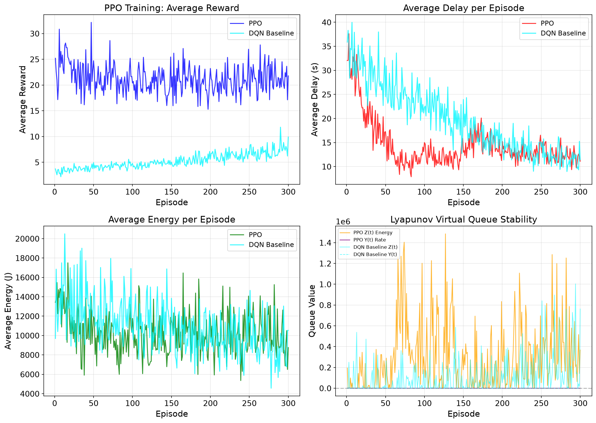

# lyapunov-ppo-uav-mec

A Gymnasium environment for **multi-UAV edge-computation offloading with a
HAP (High-Altitude Platform)**, plus a reference PPO implementation shaped by
**Lyapunov virtual-queue optimization**.

[中文文档](README.zh-CN.md) ·
[方法说明 (中文, 为什么这样设计)](docs/method.md)


## Why this repo

Not "a new algorithm" — PPO and Lyapunov optimization are established
techniques. The value here is a **clean, tested, reproducible reference
implementation** of three patterns that are hard to get right in practice:

1. **Lyapunov virtual queues → observation + reward shaping.** Long-term
   constraints (average energy budget) are turned into "debt levels" Z/Y that
   the policy can observe, combined with step-wise shaped rewards.
   ([details](docs/method.md#1-lyapunov-虚拟队列-把长期约束变成看得见的状态))
2. **Parameter sharing + ID embedding + per-agent balanced sampling** for
   learning one policy across heterogeneous agents (compute differs 10×),
   with action masks stored per-experience so PPO ratio estimates stay
   consistent. ([details](docs/method.md#2-参数共享--id-embedding--均衡采样))
3. **Multi-slot task model**: actions (fly + transmit + compute) span several
   decision slots; a busy-state machine, end-of-slot settlement and action
   masks keep this tractable.
   ([details](docs/method.md#3-多时隙任务模型-忙碌状态机--时隙末结算--动作掩码))

## The environment

- A HAP serves ground tasks through **4 fixed beams**; tasks arrive as a
  Poisson process, 85% clustered around beam hotspots (Gaussian).
- **10 heterogeneous UAVs** (1/5/10 GHz tiers, 5:3:2) decide each slot:
  `0` = onboard computing (local, or relay via HAP when nothing in reach),
  `1..4` = fly to beam cluster and take over the whole cluster's tasks.
- Observations (15-dim, normalized): own load, position, per-beam loads &
  distances, task queue Q, virtual queues Z/Y, busy flag.
- Reward: task-volume bonus − offload distance penalty + load contribution −
  normalized delay/energy penalties (all weights in `config.py`).
- Two interchangeable interfaces:
  - **Native multi-agent**: `env.step(uav_id, action)` + `env.end_of_step()`
    (exact per-UAV rewards);
  - **Standard Gymnasium**: `gym.make("UavHapMec-v0")`, `step(action)` 5-tuple
    with `info["action_mask"]` (MaskablePPO convention), passes
    `gymnasium.utils.env_checker.check_env`.

Full spec: [docs/method.md](docs/method.md).

## Quick start

```bash
pip install -r requirements.txt

# 1) Minimal demo: random / greedy / onboard-only policies on the native API
python examples/quick_start.py

# 2) Standard Gymnasium API
python - <<'EOF'
import gymnasium as gym, numpy as np, env_wrapper
env = gym.make("UavHapMec-v0")
obs, info = env.reset(seed=0)
for _ in range(100):
    valid = np.where(info["action_mask"])[0]
    obs, r, term, trunc, info = env.step(int(valid[0]) if len(valid) else 0)
    if trunc: obs, info = env.reset()
EOF

# 3) Train PPO (+ DQN / random / greedy baselines) and plot curves
python train.py --episodes 300 --baseline --dqn

# 4) Scale-out experiments + comparison bar charts
python sweep.py --sweep uav --quick        # 10..50 UAVs
python plot_comparison.py results_multi_uav/uav_comparison_config.json

# 5) Record the animated scenario GIF
python examples/make_demo_gif.py           # -> docs/img/demo.gif
```

## Reference results

A 300-episode demo run (`python train.py --episodes 300 --baseline --dqn`,
CPU, ~3 min) produces the following **fresh, unmodified** curves:



| Strategy | Reward ↑ | Delay (s) ↓ | Energy (J) ↓ |
|---|---|---|---|
| PPO (this repo) | **+20.9** | 13.4 | 10187 |
| DQN baseline | +6.3 | 14.1 | 9613 |
| Greedy (nearest beam) | +4.2 | **9.1** | **5922** |
| Random | +3.3 | 33.3 | 14200 |

Read this as a *pipeline demonstration*, not a benchmark claim: the greedy
policy remains the most delay/energy-efficient single-slot heuristic, while
PPO exploits the full action space for higher shaped reward. Absolute numbers
depend on `config.py` weights. Use the sweep tooling for your own comparisons.

## Repository layout

```
config.py            all simulation & hyperparameters (single knob board)
channel_task.py      free-space channel + Poisson task generator (rng-injectable)
uav.py               UAV entity: delay/energy models + multi-slot busy machine
hap.py               HAP: fixed-beam clustering + relay settlement
env.py               the environment (native multi-agent API) + render()
env_wrapper.py       standard Gymnasium wrapper, gym.make("UavHapMec-v0")
networks.py          shared Actor/Critic with UAV-ID embedding
balanced_buffer.py   per-UAV balanced sampling replay buffer (mask-aware)
ppo_trainer.py       GAE + clip PPO update
dqn_baseline.py      DQN baseline on the same interface
train.py             training loop + curves + CLI
sweep.py             scale experiments (UAV count / arrival rate)
plot_bars.py         per-window algorithm comparison bars
plot_comparison.py   cross-configuration comparison bars
tests/               32 pytest cases (channel, env, wrapper, buffer, trainer)
docs/method.md       design rationale (Chinese)
```

## Tests & CI

```bash
python -m pytest tests/ -q      # 32 passed
```

CI runs the suite on Ubuntu + Windows (Python 3.12, CPU torch) on every push.
The environment is bit-reproducible: `env.reset(seed=N)` drives all stochastic
components through the env-owned `np_random`.

## Roadmap

- [ ] stable-baselines3 (MaskablePPO) training example on `UavHapMec-v0`
- [ ] trajectory-accurate GAE (per-UAV, per-episode recursion)
- [ ] dynamic beam count / moving hotspot scenario
- [ ] English docstrings

## License

MIT — see [LICENSE](LICENSE).
