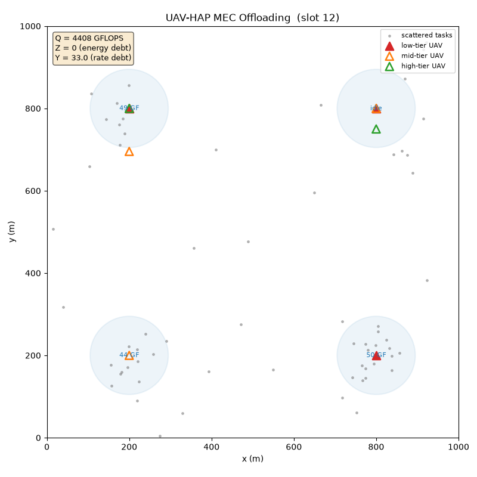

# lyapunov-ppo-uav-mec（中文说明）

一个 **多无人机 + 高空平台 (HAP) 边缘计算卸载** 的 Gymnasium 仿真环境,
附带一套 Lyapunov 虚拟队列整形奖励的 PPO 参考实现。

[English](README.md) · [方法说明: 三个值得借鉴的设计](docs/method.md)



## 这个仓库的价值

不宣称"新算法"——PPO 和 Lyapunov 优化都是成熟技术。价值在于把三项
**实践中容易做错的设计**给出了干净、带测试、可复现的参考实现:

1. **Lyapunov 虚拟队列 → 观测 + 奖励整形**: 长期能耗约束变成策略"看得见"
   的债务水平 Z/Y, 配合逐步整形奖励([详见](docs/method.md#1-lyapunov-虚拟队列-把长期约束变成看得见的状态));
2. **参数共享 + ID embedding + 按 UAV 均衡采样**: 算力差 10 倍的异构智能体
   共学一个策略, 动作掩码随经验存储保证 PPO ratio 一致性([详见](docs/method.md#2-参数共享--id-embedding--均衡采样));
3. **多时隙任务模型**: "飞行+传输+计算"跨多个决策时隙, 用忙碌状态机 +
   时隙末结算 + 动作掩码处理([详见](docs/method.md#3-多时隙任务模型-忙碌状态机--时隙末结算--动作掩码))。

## 环境

- HAP 通过 **4 个固定波束**服务地面任务; 任务泊松到达, 85% 集中在波束高斯热点;
- **10 架异构 UAV** (1/5/10 GHz 三档, 5:3:2), 每时隙决策:
  `0` = 机载计算(本地, 覆盖外则经 HAP 中继), `1..4` = 飞向波束簇承接整簇任务;
- 观测 15 维(归一化): 自身负载、位置、各波束负载/距离、任务队列 Q、
  虚拟队列 Z/Y、忙碌标志;
- 两套接口:
  - **原生多智能体**: `env.step(uav_id, action)` + `env.end_of_step()`(精确逐 UAV 奖励);
  - **标准 Gymnasium**: `gym.make("UavHapMec-v0")`, 标准五元组 + `info["action_mask"]`,
    通过官方 `env_checker` 校验。

## 快速上手

```bash
pip install -r requirements.txt

# 三种朴素策略对比(原生接口最小示例)
python examples/quick_start.py

# 标准 Gymnasium 接口
python - <<'EOF'
import gymnasium as gym, numpy as np, env_wrapper
env = gym.make("UavHapMec-v0")
obs, info = env.reset(seed=0)
for _ in range(100):
    valid = np.where(info["action_mask"])[0]
    obs, r, term, trunc, info = env.step(int(valid[0]) if len(valid) else 0)
    if trunc: obs, info = env.reset()
EOF

# 训练 PPO(+ DQN / 随机 / 贪心基线)并出曲线
python train.py --episodes 300 --baseline --dqn

# 规模实验 + 对比柱状图
python sweep.py --sweep uav --quick
python plot_comparison.py results_multi_uav/uav_comparison_config.json

# 录制场景动图
python examples/make_demo_gif.py
```

## 参考结果

300 episodes 演示运行(纯 CPU 约 3 分钟)得到的**全新未处理**数据:

| 策略 | 奖励 ↑ | 时延 (s) ↓ | 能耗 (J) ↓ |
|---|---|---|---|
| PPO (本仓库) | **+20.9** | 13.4 | 10187 |
| DQN 基线 | +6.3 | 14.1 | 9613 |
| 贪心(就近波束) | +4.2 | **9.1** | **5922** |
| 随机 | +3.3 | 33.3 | 14200 |

请把这组数当**管线演示**而非基准结论: 贪心仍是单步时延/能耗最优的启发式,
PPO 则利用完整动作空间获得了更高的整形奖励; 绝对数值依赖 `config.py`
权重。请用 sweep 工具自行跑对比。

## 测试

```bash
python -m pytest tests/ -q   # 32 passed
```

环境比特级可复现: `env.reset(seed=N)` 驱动所有随机组件(任务生成使用
环境自有 `np_random`)。CI 在 Ubuntu + Windows 上跑全套测试。

## 许可

MIT, 见 [LICENSE](LICENSE)。
